# Engine demos

Small self-contained examples of the engine's basic mechanics. They need no files from any game:
every demo has its own `engine.ini`, scripts and configs, and binary assets (textures, fonts, sounds)
made from free sources. The built assets are committed, so a demo runs as cloned; `run.sh` rebuilds
them with the `make_*.py` generators and `fetch_assets.sh` before every start. Game content does not belong here — the game lives in its own
repository and uses this engine as a submodule.

Each demo is started with `run.sh <path to built engine executable>` from its folder.
`common/record.sh` records a run to a video with scripted input (`RECORD_AUDIO=1` adds the sound). How the engine works, the formats and a recipe per demo are described (in Russian) in [`docs/ru`](../docs/ru).

| Mechanic | Demo | Status |
|---|---|---|
| Window, DX9 renderer (dxvk on Linux), script VM, sound service | [`tools/smoke-test`](../tools/smoke-test) | done, runs headless-ish and exits with a check |
| Interface (XINTERFACE screens, text buttons, pictures, string collections) | [`interface`](interface) | done |
| Bitmap fonts and localized strings (`fonts.ini`, `language.ini`, `common.ini`) | [`interface`](interface) | done |
| Input: keyboard and mouse controls (`pcs_controls`, `MapControl`) | [`interface`](interface) | done |
| Textures in `.tx` format | [`interface`](interface) | done |
| Static 3D models (`.gm`) with textures and materials, placed and rotated by script | [`model`](model) | done |
| Free camera (`FREE_CAMERA` run by the `Scene` entity) | [`model`](model) | done |
| Dynamic sun light, ambient and fog (`weather` attributes + `DLightModel` technique) | [`model`](model) | done |
| Skeletal animation: skinned `.gm`, `.an` skeleton, `.ani` actions played and switched by script | [`character`](character) | done |
| Locations: model with BSP (traces, shadows), walkable `.ptc` patch, player character controller, following camera | [`location`](location) | done |
| Sea (animated waves, cube-map sky reflection, foam), skybox, weather presets switched by script | [`sea`](sea) | done |
| Ship: hull, masts and sails from `.gm` labels, sails in the wind, helm and sail controls, ship camera | [`ship`](ship) | done |
| Particles: fire and smoke, cannonball splashes and blasts from `.xps` systems | [`particles`](particles) | done |
| Dialogs: branching answers, a text field, paging, the speaker's name plate | [`dialog`](dialog) | done |
| Save / load: `SaveEngineState`/`LoadEngineState`, `OnSave`/`OnLoad`, rebuilding entities from restored attributes, on-screen log | [`save`](save) | done |
| Music and 3D sound: streamed music with crossfade, looped and one-shot 3D sounds, aliases, the ambient scheme | [`sound`](sound) | done |
| Naval battle: broadsides, cannonballs (`AIBalls`), hits on the hull, sails and masts, shot holes, sinking | [`battle`](battle) | done |
| Enemy ship AI: `SEA_AI` sails the enemy into range, turns its broadside and fires the guns that bear; cannons as model labels | [`ai-ship`](ai-ship) | done |
| Island: land and sea floor models, a depth map with shallows and a reef, ships striking the shore (`touch`), `SEA_AI` steering round the land, balls hitting the slope | [`island`](island) | done |

## Videos

A recorded run of every demo (`common/record.sh`); click a frame to open the video.

|   |   |   |   |   |
|---|---|---|---|---|
| [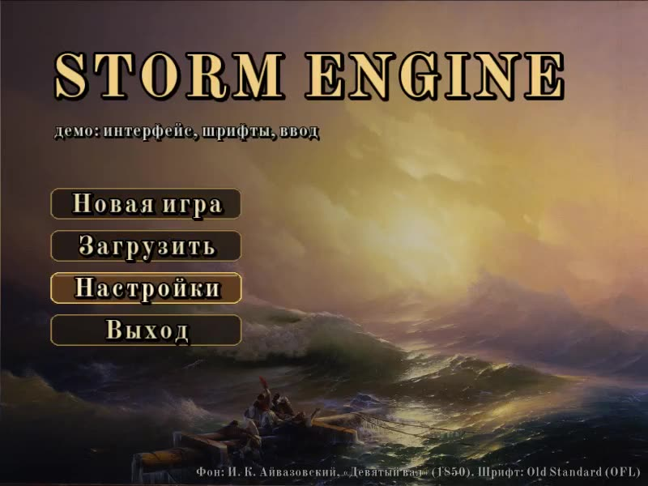](interface/media/interface.mp4) Interface | [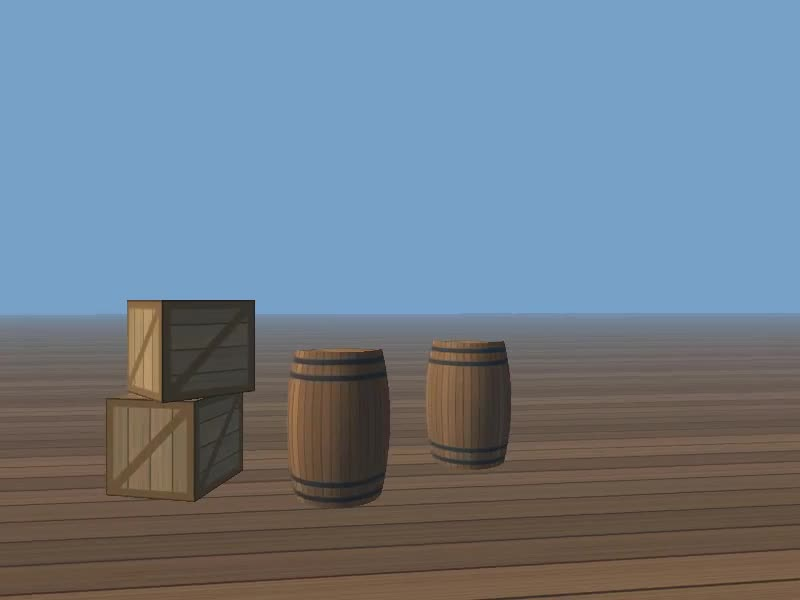](model/media/model.mp4) Models | [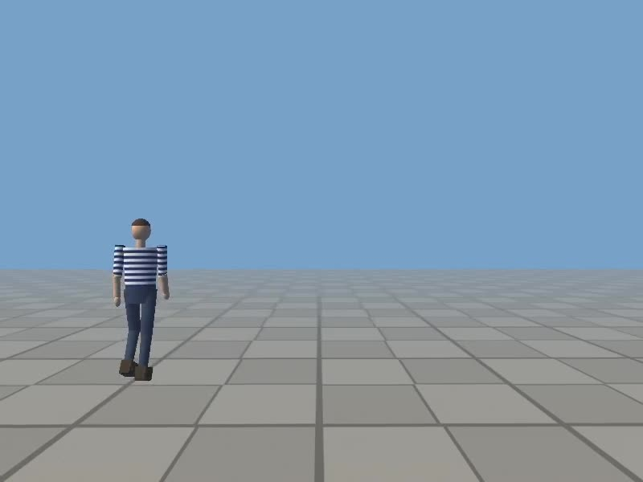](character/media/character.mp4) Character | [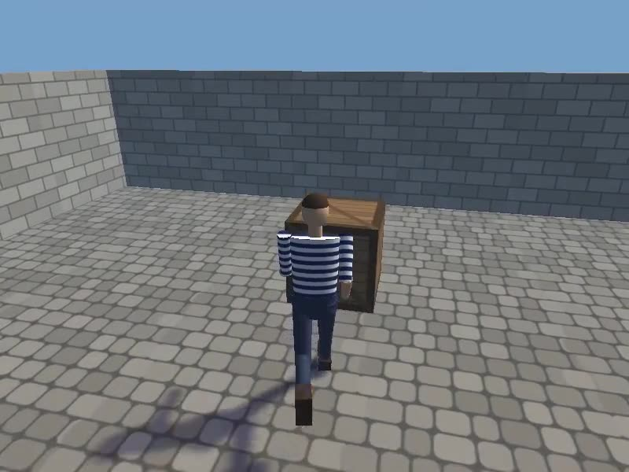](location/media/location.mp4) Location | [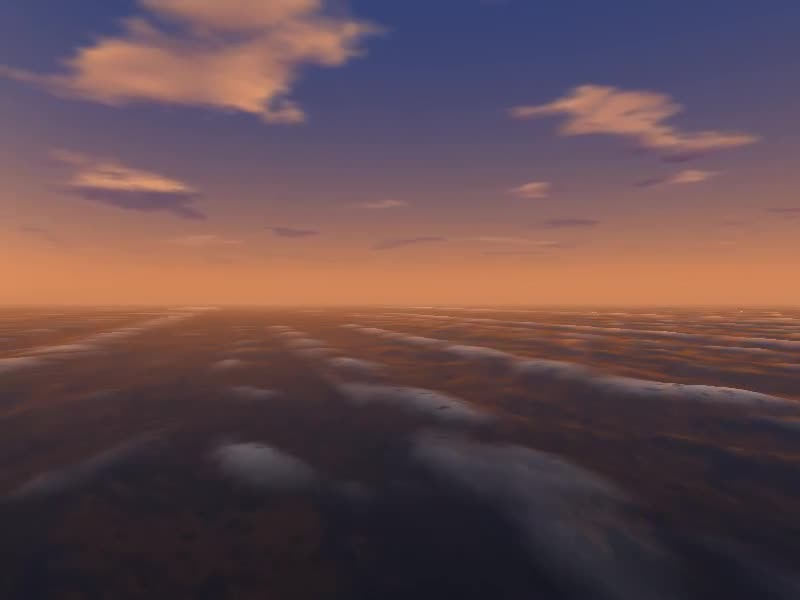](sea/media/sea.mp4) Sea |
| [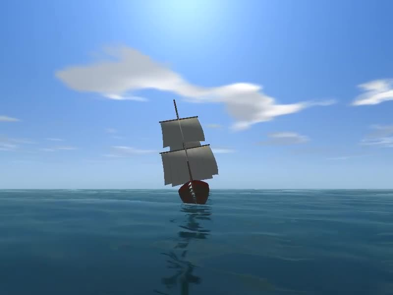](ship/media/ship.mp4) Ship | [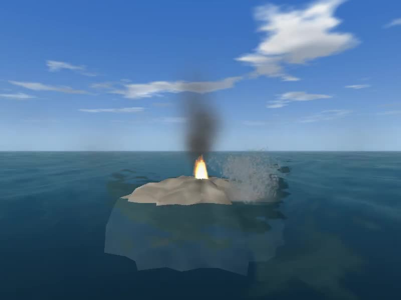](particles/media/particles.mp4) Particles | [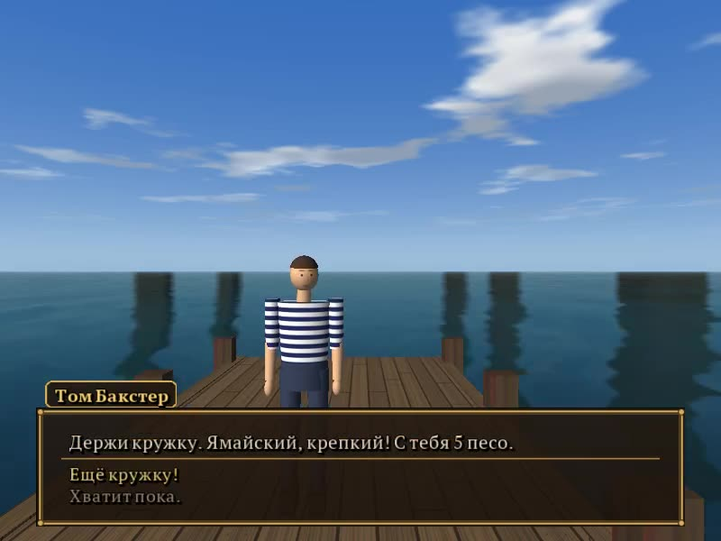](dialog/media/dialog.mp4) Dialog | [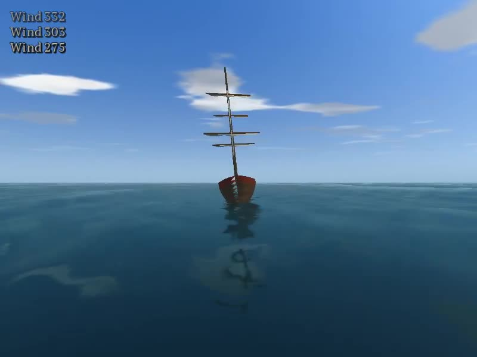](save/media/save.mp4) Save / load | [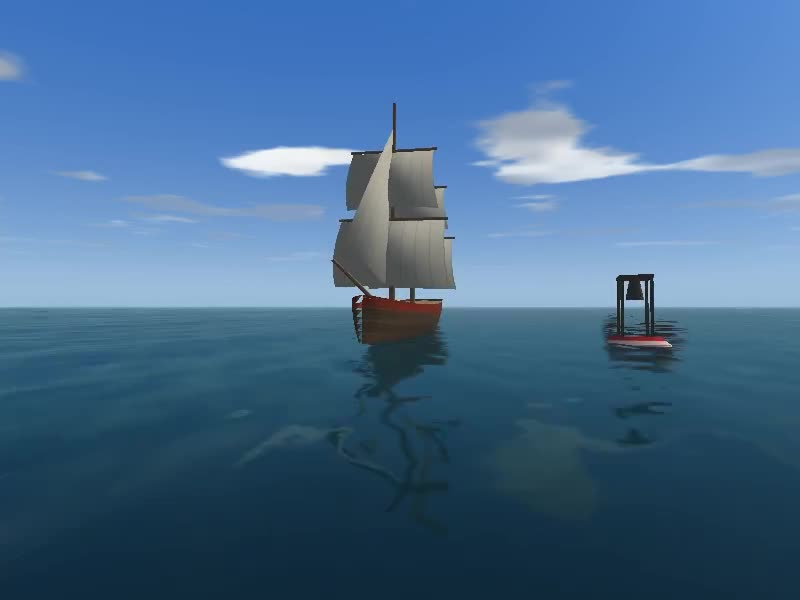](sound/media/sound.mp4) Sound |
| [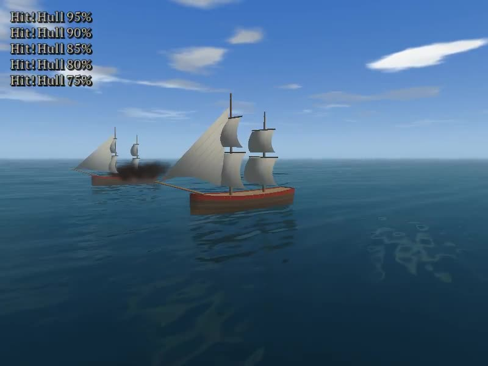](battle/media/battle.mp4) Battle | [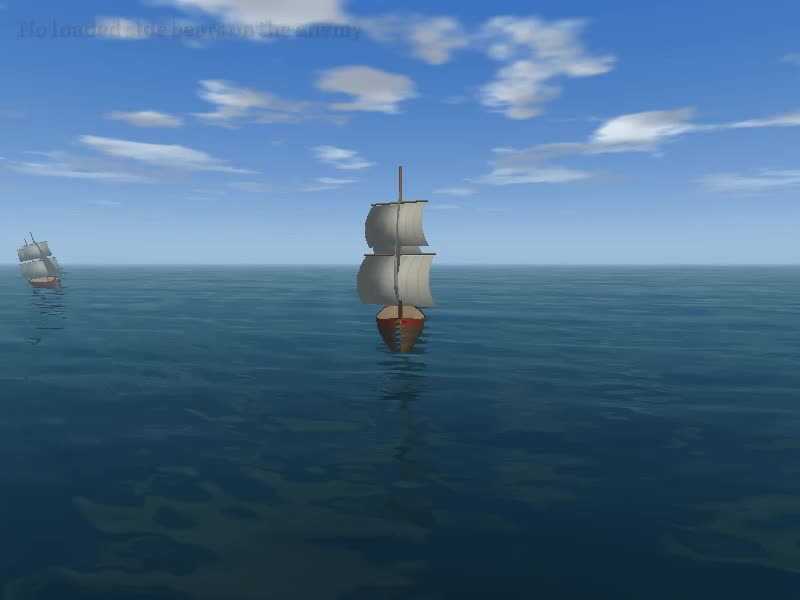](ai-ship/media/ai-ship.mp4) Enemy ship | [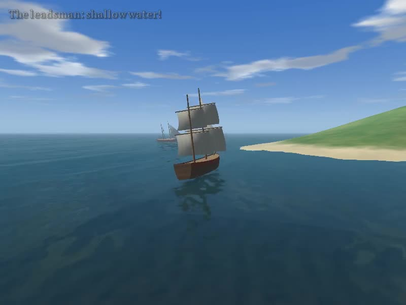](island/media/island.mp4) Island |   |   |
