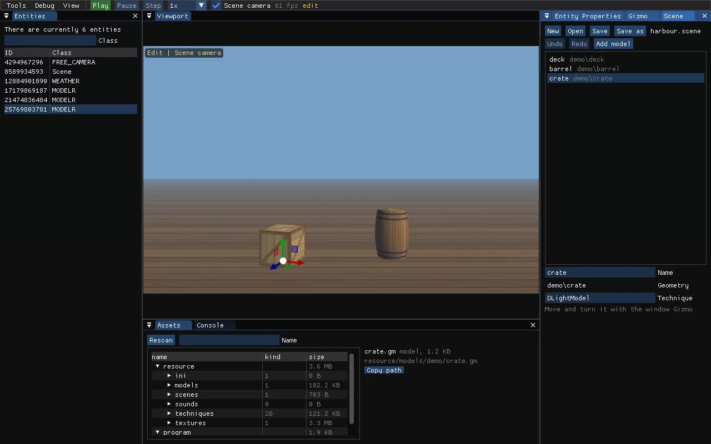
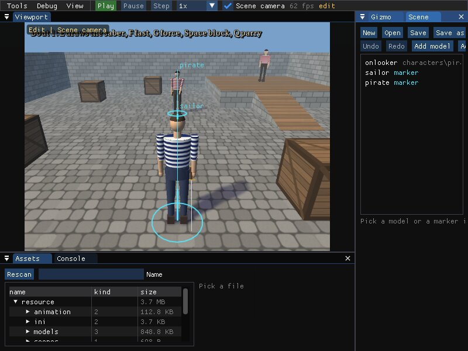
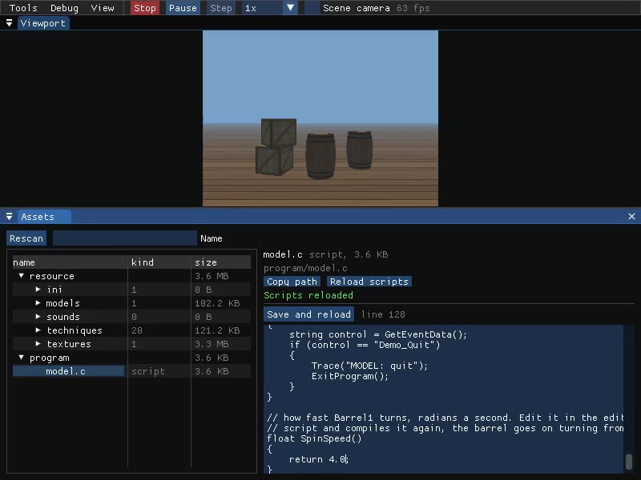
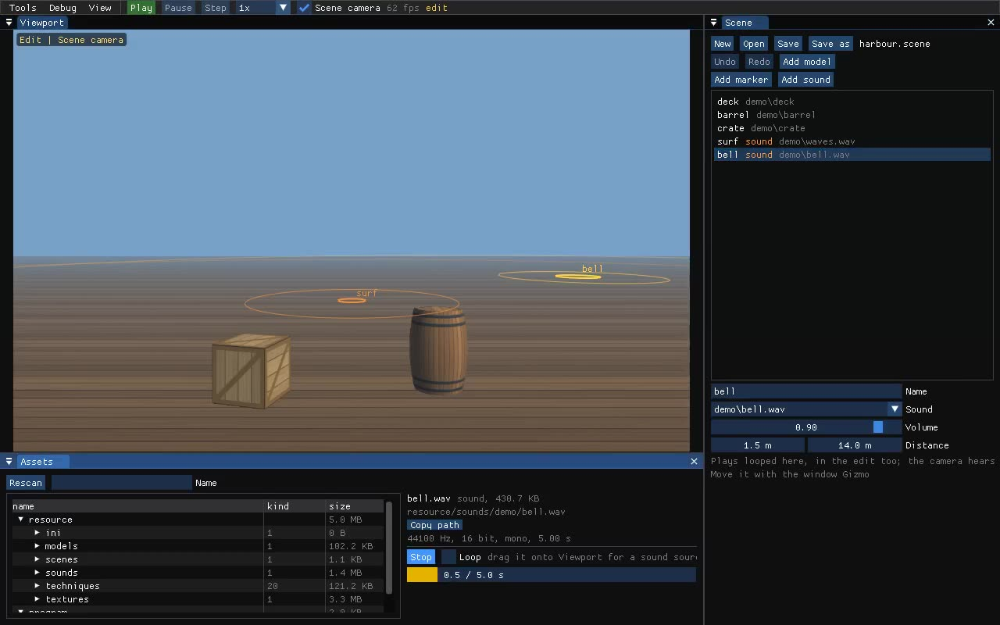
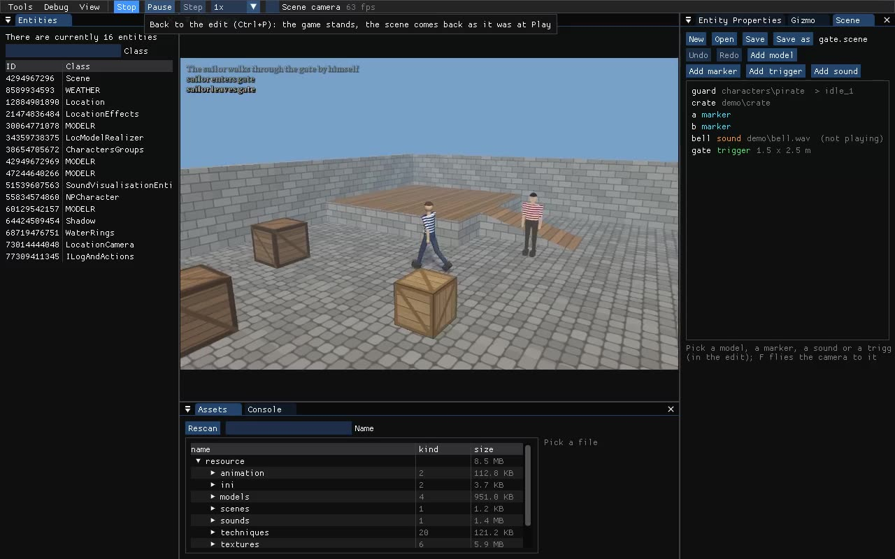

# 09. Редактор: как пользоваться

Встроенный редактор Storm Engine — рабочее место в духе Godot или Unity. Он открывается поверх любого демо и игры, на Windows и Linux. Окна инструментов лежат в отдельном git-модуле [storm-editor](../../src/libs/editor_tools) (`src/libs/editor_tools`), рабочее место, панель инструментов и камера — в движке (`src/libs/editor`). Как это устроено внутри — [06 §6.21](06-recipes.md). Что ещё будет — [10](10-editor-roadmap.md).



## 1. Запуск

Редактор включается ключом `--editor`:

```bash
demos/scene/run.sh build/Debug/engine --editor     # пустой проект со сценой
demos/melee/run.sh build/Debug/engine --editor     # любое другое демо
```

Без ключа движок работает как обычно, а редактор не тратит ни кадра.

С ключом окно движка получает рамку: его можно двигать, растягивать, разворачивать и закрывать. При изменении размера рендер пересоздаёт back buffer под новое окно, раскладка панелей подстраивается сама. Без редактора окно игры остаётся без рамки и фиксированного размера (`window_borders` в `engine.ini`).

## 2. Рабочее место

| Где | Что |
|---|---|
| сверху | меню **Tools / Debug / View** и панель инструментов: **Play/Stop**, **Pause**, **Step**, скорость, **Scene camera**, fps |
| в центре | **Viewport** — кадр игры |
| слева | **Entities** — все сущности движка |
| справа | **Entity Properties** (инспектор) и вкладки остальных окон: Scene, Gizmo, Animation… |
| снизу | **Assets** (файлы игры) и **Console** (логи) |

- Панели можно перетаскивать за заголовок, стыковать с другими и делать вкладками. Раскладка сохраняется сама.
- **View → Reset layout** возвращает исходную раскладку.
- **View → Workspace** (снять галочку) возвращает старый режим: окна плавают поверх игры на весь экран.
- **F10** (**View → Game only**) прячет редактор целиком, повторное нажатие возвращает.
- **Tools** открывает и закрывает окна. Открытые окна откроются и при следующем запуске.

## 3. Edit и Play

Как в Unity, у редактора два режима.

**Edit** (кнопка зелёная, надпись **Play**):
- игра стоит, скрипты и сущности не получают времени;
- сцену видно через свободную камеру;
- щелчок в Viewport выбирает модель.

**Ctrl+P** переключает Edit и Play, как в Unity.

**Play** (кнопка красная, надпись **Stop**):
- игра идёт;
- щелчок в Viewport отдаёт клавиатуру и мышь игре, **F1** возвращает их редактору;
- **Pause** останавливает время, **Step** пропускает один кадр, список скорости замедляет или ускоряет игру (0.1x–4x).

**Stop** возвращает модели окна Scene в то состояние, в котором они были при нажатии Play: и правки в Play, и то, что сделали скрипты (`SceneObjectShow`, `SceneObjectMove`, `SceneObjectAction`). Save в Play пишет сцену такой, какой она была при Play. Что успели сделать скрипты с остальными сущностями, не откатывается. Если редактор открыт в Edit при старте игры, окно Scene показывает сцену такой, какой её загрузил `LoadScene`, до скриптов.

Курсор мыши виден над окнами редактора и в Edit; в Play во Viewport и при полёте камеры мышь уходит игре (на Linux — в relative-режиме SDL).

Режим запоминается: если закрыть редактор в Edit, он и откроется в Edit.

## 4. Свободная камера

Свободная камера включена в Edit всегда, а в Play — если отмечен флажок **Scene camera**. Она стартует там, где стоит камера игры. Работает с любой камерой: локация, корабль, карта мира.

| Действие | Как |
|---|---|
| осмотреться | держать **правую кнопку мыши** во Viewport и вести мышь |
| лететь | при зажатой правой кнопке **W A S D**, вверх/вниз **E / Q** |
| быстрее | **Shift** |
| скорость полёта | **колесо мыши** при зажатой правой кнопке |

## 5. Сцена с нуля

Окно **Scene** (`Tools → Scene`) собирает сцену из моделей, сохраняет её в файл, а игра этот файл загружает.

1. **New** — пустая сцена.
2. Модель в сцену добавляется одним из двух способов:
   - перетащить файл `.gm` из **Assets** (`resource/models/…`) на **Viewport**. Модель встанет туда, куда указывает мышь: на поверхность другой модели, иначе на землю (y = 0), иначе в 8 м перед камерой;
   - или **Add model** — список всех `.gm` с фильтром; модель встанет в центр кадра.
3. Чтобы выбрать модель, щёлкните по ней во Viewport (в Edit) или по строке в списке окна Scene. Выбранная модель становится выбранной и в Entities, Entity Properties и Gizmo.
4. Двигают и поворачивают модель в окне **Gizmo**:
   - стрелками и кольцами прямо во Viewport или числами Position / Rotation;
   - **Move / Rotate** — режим гизмо, **World axes** — оси мира вместо осей модели, **Snap** — шаг в метрах или градусах.
5. В окне Scene у выбранной модели есть:
   - **Name** — имя;
   - **Technique** — шейдер (`DLightModel` освещает модель солнцем). Технику меняют вводом названия и Enter. Для новых моделей техника по умолчанию берётся из `Scene.Technique=` в `imgui.ini`, пусто — своя техника модели;
   - **Textures** — папка текстур, если модель называет их без папки (персонажи: `characters`). Ставится сама при добавлении модели;
   - **Animation** и **Action** — у модели с костями: скелет (`resource/animation/<имя>.ani`, Enter) и действие из списка, которое она играет с загрузки. Так в сцене стоят часовой, зевака, торговец за прилавком;
   - правый щелчок по строке — **Duplicate** и **Delete**.
6. **Save as** — имя файла, сцена ляжет в `resource/scenes/<имя>.scene`. Дальше хватает **Save** или **Ctrl+S**. Звёздочка у имени значит «есть несохранённые изменения».
7. **Open** — список сцен из `resource/scenes`. Последняя открытая сцена откроется при следующем запуске редактора, если игра не загрузила свою.

### Персонажи: маркеры

Игрока и NPC с ИИ сцена не создаёт: им нужны локация, патч, группы и обработчики событий, это дело скрипта. Сцена говорит, **где** им стоять.

1. **Add marker** — маркер в центре кадра. Во Viewport (в Edit) он виден голубым кольцом на земле со стрелкой — куда смотрит персонаж — и именем; выбранный — жёлтый.
2. Выберите маркер щелчком по кольцу или по строке списка, задайте **Name** (`player`, `pirate`…), двигайте и поворачивайте его в **Gizmo**.
3. Скрипт берёт место по имени:

```c
native int LoadScene(string name);
native int GetSceneMarker(string name, ref place);
#library "SceneLibrary"
#library "SceneMarkers"

void PlacePirate()
{
	object place;
	if (GetSceneMarker("pirate", &place))   // 0, если маркера нет
	{
		SendMessage(&Pirate, "lffff", MSG_CHARACTER_TELEPORT_AY, stf(place.x), stf(place.y), stf(place.z), stf(place.ay));
	}
}
```

Пример — демо [`demos/melee`](../../demos/melee): фехтовальщики встают на маркеры `sailor` и `pirate` из `resource/scenes/yard.scene`, а на помосте стоит пират-зевака — анимированная модель сцены. Передвиньте маркер, **Save**, перезапустите — бой начнётся в новом месте.



### Отмена

Каждое изменение сцены можно отменить: добавление, удаление, перенос гизмо, правку чисел и имени. Отмена срабатывает, когда изменение закончено (кнопка мыши отпущена).

| Клавиши | Что |
|---|---|
| **Ctrl+Z** | отменить |
| **Ctrl+Y**, **Ctrl+Shift+Z** | вернуть |
| **Ctrl+D** | копия выбранной модели или маркера (на полметра в сторону) |
| **Delete** | удалить выбранную модель или маркер |
| **Ctrl+P** | Play / Stop |
| **Ctrl+S** | сохранить |

Клавиши не работают, пока курсор в поле ввода и пока в Play клавиатура отдана игре.

### Сцена в игре

Скрипт объявляет функцию как `native`, **затем** подключает библиотеку модуля и загружает сцену по имени. Библиотека привязывает только то, что объявлено до неё: без объявления или в обратном порядке будет `native function 'LoadScene' not declared` / `Undeclared identifier`.

```c
native int LoadScene(string name);
#library "SceneLibrary"

void Main()
{
	// камера, солнце, туман — как обычно
	int models = LoadScene("harbour");   // resource/scenes/harbour.scene, -1 если файла нет
}
```

Модели сами встают в слои `EXECUTE` и `REALIZE`. Если игра загрузила сцену, редактор подхватит её в окне Scene: правки идут в ту же сцену, и Save перезапишет тот же файл. Пример — демо [`demos/scene`](../../demos/scene).

### Файл `.scene`

Обычный TOML, его можно править руками. Строки в одинарных кавычках: в них `\` пути пишется как есть (подробно — [04 §4.16](04-formats.md)).

```toml
[[model]]
name = 'crate'
geometry = 'demo\crate'        # resource/models/demo/crate.gm
technique = 'DLightModel'       # можно не писать
# textures = 'characters'       # папка текстур, если .gm называет их без папки
# animation = 'fencer'          # скелет resource/animation/fencer.ani
# action = 'idle_1'             # что играет с загрузки
position = [ -1.4, 0.0, 0.4 ]   # метры; можно не писать — 0, 0, 0
axes = [ 0.9553, 0.0, -0.2955,  # оси x, y, z модели; можно не писать — без поворота
         0.0, 1.0, 0.0,
         0.2955, 0.0, 0.9553 ]

[[marker]]                      # после всех моделей
name = 'player'
position = [ 0.0, 0.0, -5.0 ]   # и axes, как у модели: ось z — куда смотрит
```

### Модели из Blender

Модель из Blender, Kenney или Sketchfab импортируется прямо в редакторе:

1. Blender: **File → Export → glTF 2.0**, формат **glTF Binary (.glb)**. Единицы — метры, ось Y вверх (по умолчанию).
2. Положите `.glb` в папку `source/` игры или демо (или в `resource/`) и нажмите **Rescan** в **Assets**.
3. Выберите файл: справа поле **Folder** (папка в `models/` и `textures/`, по умолчанию `imported`) и кнопка **Import**.
4. После импорта Assets сам выберет новую модель `resource/models/<Folder>/<имя>.gm` — бросьте её на Viewport.

Импорт идёт в фоне, игра не встаёт. Вывод конвертера виден у модели, в `system.log` — строка `EDITOR: import …`. Нужен Python 3 с Pillow (`python3` на Linux, `python` на Windows). Без редактора то же делает команда:

```bash
python3 tools/gltf2gm/gltf2gm.py ship.glb --out resource --folder harbour
```

Пример — демо [`demos/gltf`](../../demos/gltf): бухта из моделей glTF. Что переносится и что нет — [04 §4.17](04-formats.md), рецепт — [06 §6.22](06-recipes.md). Персонажи с костями — аддоном `tools/blender-gm-export`.

### Скрипты

Скрипты (`.c` в `program/`) правятся прямо в окне **Assets**, без перезапуска игры:

1. Выберите файл в дереве: справа откроется редактор текста (Tab вставляет табуляцию, внизу номер строки и пометка `modified`).
2. **Ctrl+S** или **Save and reload** сохраняют файл и сразу компилируют скрипты заново. Зелёная строка **Scripts reloaded** — новый код уже работает.
3. Ошибка компиляции видна над текстом: `model.c(128): Undeclared identifier: nope`. Щелчок по ней открывает файл и выделяет строку. Пока ошибка не исправлена, игра работает на старом коде (красная строка **Not reloaded, the old code runs**).

**Reload scripts** перекомпилирует без сохранения, например после правки во внешнем редакторе. Файлы, открытые без изменений, перечитываются с диска.

Что сохраняется при перезагрузке:
- значения глобальных переменных и атрибуты объектов (сущности ссылаются на них), обработчики событий, сущности и слои;
- `Main()` заново не вызывается. Новая глобальная переменная получает начальное значение из объявления, изменённое начальное значение у старой не применяется.

Пример — `demos/model`: скорость вращения бочки задаёт функция `SpinSpeed()` в конце `program/model.c`. Поменяйте `0.8` на `4.0` и нажмите Ctrl+S — бочка закрутится быстрее с того же угла.



### Звуки

1. **Прослушать.** В **Assets** выберите файл в `resource/sounds` (`.wav`, `.ogg`, `.mp3`). Справа — частота, разрядность, моно/стерео и длительность (у WAV), кнопка **Play**/**Stop**, флажок **Loop** и полоса прогресса.
2. **Поставить в сцену.** Бросьте файл на Viewport или нажмите **Add sound** в окне Scene. Источник — маркер со звуком: в списке он помечен оранжевым `sound`, на Viewport — оранжевые круги (малый — сам источник, средний — `Min`, бледный — `Max`; выбранный — жёлтый). Двигается гизмо, как маркер.
3. **Настроить.** В свойствах: **Sound** (файл), **Volume** (0–1), **Distance** (до Min громкость полная, за Max звука нет). Звук перезапускается, когда правка закончена.

Слушатель — камера: со свободной камерой (раздел 4) громкость и панорама меняются на лету, в Edit тоже. В файле сцены источник — `[[sound]]` ([04 §4.16](04-formats.md)), рецепт — [06 §6.24](06-recipes.md).



### Триггеры

Зона, в которую входит персонаж или корабль. **Add trigger** в окне Scene ставит её в точку перед камерой. В списке она помечена зелёным `trigger` с размерами, на Viewport — зелёный цилиндр (два кольца и четыре стойки). В свойствах **Radius** и **Height** (м); двигается гизмо. В файле — `[[trigger]]` ([04 §4.16](04-formats.md)).

Скрипт сообщает, кто где (`CheckSceneTriggers("sailor", x, y, z)` из своего тика), и получает события `SceneTriggerEnter` и `SceneTriggerExit` с `(trigger, who)`. Объекты сцены меняет библиотека `SceneObjects`: `SceneObjectAction`, `SceneObjectShow`, `SceneObjectMove`. Рецепт — [06 §6.25](06-recipes.md), демо — [`demos/trigger`](../../demos/trigger).



### Горячие клавиши сцены

| Клавиша | Что делает |
|---|---|
| **W** | гизмо: перенос |
| **E** | гизмо: поворот |
| **F** | свободная камера подлетает к выбранному объекту |
| **Esc** | снять выделение |
| **Del**, **Ctrl+D** | удалить, дублировать |
| **Ctrl+Z**/**Ctrl+Y**, **Ctrl+S** | отмена/повтор, сохранить |

Клавиши работают, когда в фокусе Viewport или Scene, правая кнопка не зажата (с ней W — полёт) и курсор не в поле ввода. В Play, пока Viewport отдан игре, клавиши её.

## 6. Остальные окна

| Окно | Для чего |
|---|---|
| **Entities** | все сущности с классом и фильтром; выбранная открывается в Entity Properties |
| **Entity Properties** | слои и приоритеты сущности, дерево атрибутов с правкой значений, свои поля класса (у персонажа — действия анимации, у локации — локаторы) |
| **Gizmo** | перенос и поворот модели или локатора; **Copy as script** — строка для скрипта (в буфер обмена и в `compile.log`) |
| **Animation** | анимация выбранной модели или персонажа: проигрыватели, действия по кадрам, граф переходов; щелчок по действию проигрывает его |
| **Assets** | дерево `resource/`, `program/` и `source/` с типом и размером; **Import** у `.glb`/`.gltf`; текстовые файлы (`.ini`, `.ani`, `.c`, `.fx`, до 256 КБ) правятся справа, Ctrl+S сохраняет, у скриптов — с перезагрузкой (раздел 5); **Copy path**; звуки `resource/sounds` — **Play**/**Stop**, **Loop**, данные WAV (раздел 5); модель или звук тянется мышью во Viewport |
| **Console** | логи по вкладкам: System, Errors (вкладка красная, если там что-то есть — `error.log` должен быть пуст), Scripts (компиляция и `Trace`); фильтр, **Errors only**, **Clear** |
| **Debug** (меню) | каркас, отладка звука, локаций, пушек кораблей |

Игра (`corsairs-remake`) добавляет свои окна — Market, Dialog, Map. Они появляются в **Tools** рядом с окнами движка.

## 7. Где что хранится

- **Состояние редактора** — `imgui.ini` в папке игры или демо, секция `[Storm][Editor]`:

  | Ключ | Что хранит |
  |---|---|
  | `Open=` | открытое окно, по строке на окно |
  | `Editor.Layout=workspace\|overlay` | раскладка |
  | `Editor.Mode=edit\|play` | режим |
  | `Editor.SceneCamera=` | свободная камера в Play |
  | `Scene.File=` | последняя сцена |
  | `Scene.Technique=` | техника новых моделей |
  | `Entities.Class=`, `Entities.Index=` | выбранная сущность |
  | `Gizmo.Operation=`, `Gizmo.Space=`, `Gizmo.Snap=` | настройки гизмо |
  | `Assets.File=` | выбранный файл в Assets |
  | `Assets.ImportFolder=` | папка импорта glTF |
  | `Console.ErrorsOnly=` | фильтр консоли |

  Этот файл можно положить заранее, чтобы редактор открылся с нужными окнами. Так его проверяют автотесты.
- **Сцены** — `resource/scenes/*.scene`.
- **Логи** — `~/.local/share/Akella/Sea Dogs/Logs/` на Linux.

## 8. Ограничения

- Сцена состоит из моделей (`MODELR`, в том числе анимированных), маркеров, источников звука и триггеров. Камера, солнце, туман и частицы задаются скриптом, игрок и NPC — тоже, но встают на маркеры.
- Щелчок и бросок попадают точно по треугольникам только у моделей с BSP (`write_gm(..., bsp=True)`). У остальных модель выбирается по габаритному боксу её узлов.
- Модели нельзя масштабировать: в гизмо есть только перенос и поворот.
- Stop откатывает только модели сцены, но не переменные скриптов и не другие сущности.
- Интерфейс самой игры (меню XINTERFACE) внутри Viewport получает мышь без пересчёта координат. Для меню удобнее F10.
- Импорт glTF (раздел 5) берёт только статику: без костей и анимаций. Модели с костями — аддоном `tools/blender-gm-export`.
- Перезагрузка скриптов не вызывает `Main()` и не пересоздаёт сущности: то, что `Main()` уже создал, остаётся как было. Ошибка в `#define` после неудачной компиляции может потерять определения, объявленные ниже её, до следующей успешной перезагрузки.
- Источник звука играет один файл по кругу всё время, пока сцена загружена: без расписания, случайных пауз и затухания. Только моно звучит объёмно.
- Анимированная модель сцены играет одно действие, пока скрипт не сменит его (`SceneObjectAction`). Окно Animation меняет его вручную.
- Триггер — только вертикальный цилиндр. Сам он ни за кем не следит: позицию сообщает скрипт.
